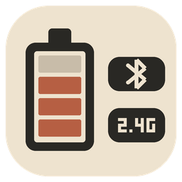
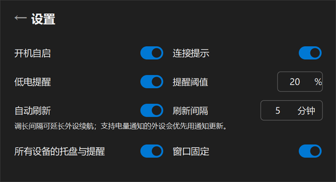
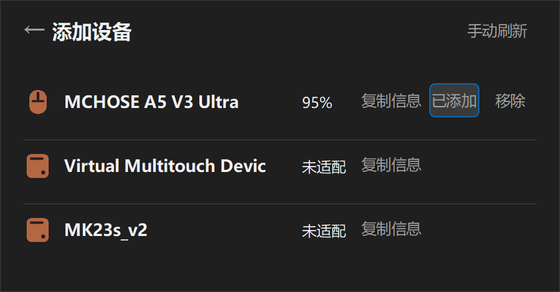

# Quiet Battery · 外设电量



Windows 原生外设电量托盘工具。Rust + Win32，单 EXE，后台低频读取；按设备保存电量、托盘选择和低电提醒。

**[下载 Windows x64 稳定版](https://github.com/TheWebDog/quiet-battery/releases/latest)** · [设备扩展](docs/ADDING_DEVICES.md) · [商业授权](COMMERCIAL.md)

## 使用

1. 在 Releases 下载 `quiet-battery-windows-x64.exe`，放到准备长期保留的文件夹后运行。无需安装 Rust、Python 或网页运行时。
2. 左键托盘打开主窗口，右键打开菜单。受支持的鼠标默认监控；其他设备通过“添加设备”选择。
3. 在“设置”开启自启、设置低电阈值，以及分别选择设备的托盘和提醒。关闭窗口继续运行；菜单“退出”才结束程序。

设置和上次成功电量统一保存在 `%LOCALAPPDATA%\QuietBattery\devices-v2.state`，EXE旁不再创建文件或文件夹。首次升级自动迁移原EXE旁 `data` 中的设置；确认新文件内容一致后删除旧设置及过期运行快照，只删除空的旧 `data` 文件夹，不动其他文件。新位置已有设置时优先使用；冲突的旧设置保留，避免覆盖丢失。若升级前移动过EXE，请把旧 `data` 一起放回新EXE旁，运行一次完成迁移。

移动EXE不再影响设置；开启自启后移动EXE仍需重新设置自启。卸载时先关闭自启、退出，再删除EXE；需要清除偏好时删除上述用户数据目录。`--status` 只在请求时通过内存消息返回JSON，不自动保存诊断文件。

程序未做代码签名。Windows 如提示未知发布者，可先对照 Release 中的 SHA256 校验下载文件。

## 界面

以下为0.1.1运行程序的实际截图；0.2.0至0.2.2沿用相同界面。







## 功能

- 型号、真实百分比、十格满量程电池和手动刷新。精细数据支持部分填充；纯档位由适配器归一化，例如3/4→75%。
- 休眠或超时保留上次电量；确认断开才隐藏，重连自动恢复。没有成功值时显示未知。
- 每台设备独立托盘：设备填色图标与连续电量尺，悬停查看百分比。主窗口与托盘共用设备造型。
- 默认低电阈值20%：严格低于时提醒一次，严格超过后恢复资格；充电时抑制，确认充电结束且仍低电时再提醒。重启、重连、关闭再开启提醒不重置已通知周期。使用 Windows 原生通知。
- 设备提供可确认的充电状态时显示闪电，不猜测充电和续航。

## 支持范围

| 设备/协议 | 当前范围 |
|---|---|
| 罗技 G304，接收器046D:C53F | 已完成真机读取、错误保留及恢复检查；报告90就显示90%，数值随固件档位跳变 |
| 达摩鲨 N3，接收器248A:FF30 / 配对设备248A:FF10 | v0.2.1新增：本机经2.4G真实读到9%，已接入Registry与后台缓存并核对实际窗口；仅覆盖这一组合，充电、物理拔插仍待补测 |
| Logitech HID++ | 已实现0x1000和能力校验后的0x1004；后者仅报文夹具验证，其他型号仍需本机验证 |
| 标准蓝牙 BAS：180F / 2A19 | 用户反馈显示正常，本机程序也真实读到广播名BT5.0 KB的100%并核对实际窗口；未确认零售型号，订阅及充电场景未测 |
| 其他厂商 | 需要验证共用协议或增加独立适配器；枚举到设备不等于能读电量 |

v0.2.2 是正常稳定发布，支持边界以上表为准。16类图标不代表16类协议已适配；蓝牙已有用户实测反馈，仍不能据此列出未经确认的型号或充电能力，其他 HID++ 型号也需分别验证。未适配设备可复制后台缓存的集合、标识和元数据来源，用于继续适配。程序不联网、不上传设备数据。

可用 `--diagnose` 导出被动 HID 集合清单：包括厂商/产品字符串、Windows 属性、来源、字段失败和报文最大长度。它不查询电量，不打开输入流；默认隐藏本机路径和容器标识。它只覆盖 HID 接口，不能代替所有 USB、PnP 或 BLE 设备清单。命令与导出方法见 [诊断说明](docs/DEVELOPMENT.md)，后续调查见 [扩展指南](docs/ADDING_DEVICES.md)。

资源实测与验证边界见 [验证记录](docs/VALIDATION.md)。G304发布记录与N3本地开发验证分别记录，不代表长期稳定性或所有外设的结果。FL980尚未通过2.4G取得可解释的真实电量，按用户要求搁置，保持未支持。

## 构建与继续开发

需要 Windows、Rust stable（本轮使用1.94.0）、MSVC 工具链及 Windows SDK：

```powershell
./tools/build.ps1
```

脚本执行格式检查、单元测试、Clippy 和 release 构建，成品为 `dist/quiet-battery.exe`。依赖及构建缓存保存在 `.build` 下。提交的图标资产可直接构建；只有修改图标时才需要 Python / Pillow。

- [实现结构与技术选择](docs/ARCHITECTURE.md)
- [新增厂商与型号](docs/ADDING_DEVICES.md)
- [构建、诊断和发布](docs/DEVELOPMENT.md)
- [视觉与交互约定](docs/DESIGN.md)
- [后续任务](docs/NEXT-TASKS.md)
- [代理约定](AGENTS.md) · [参与开发](CONTRIBUTING.md)

## 许可与来源

源码公开，采用 [PolyForm Noncommercial 1.0.0](LICENSE)。许可范围内可非商业使用、修改和分发；未获该许可允许的商业用途须取得[单独授权](COMMERCIAL.md)。这属于非商业源码许可，并非 OSI 定义的开源许可。依赖保留各自的[第三方许可](THIRD_PARTY_NOTICES.txt)，EXE 内也包含许可，可用 `--licenses` 导出。

灵感来自 [2.4G-battery-viewer](https://github.com/yszyszysz233/2.4G-battery-viewer)。当前实现使用 Rust、公开 HID++ / BAS 协议资料及本机验证；该项目列出的 ATK / DARKRIM 设备不因此成为本项目已支持型号。
